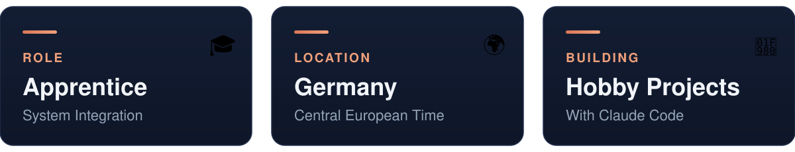

<picture>
  <source media="(prefers-color-scheme: light)" srcset="assets/header-light.svg">
  
</picture>

 

<h2 align="center">Hi, I'm Jannik 👋</h2>

  I'm an apprentice <b>IT Specialist for System Integration</b> based in Germany. 
  In my free time I build hobby projects – mostly together with <b>Claude Code</b> 🦀

 

<picture>
  <source media="(prefers-color-scheme: light)" srcset="assets/cards-light.svg">
  
</picture>

<picture>
  <source media="(prefers-color-scheme: light)" srcset="assets/walk-light.svg">
  
</picture>

<h2 align="center">How I Build</h2>

<picture>
  <source media="(prefers-color-scheme: light)" srcset="assets/terminal-light.svg">
  
</picture>

 

<picture>
  <source media="(prefers-color-scheme: light)" srcset="assets/scene-light.svg">
  
</picture>

 

<picture>
  <source media="(prefers-color-scheme: light)" srcset="assets/outro-light.svg">
  
</picture>

